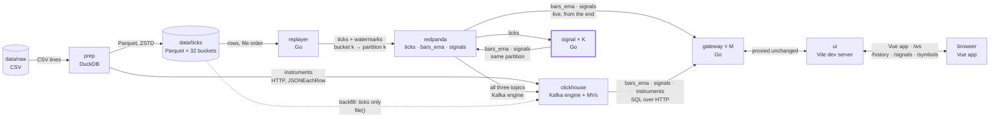

# Stock Signals — Plan (2026-11-04)

Short, opinionated version of the implementation plan. It is the spec for the starter `compose.yaml`. This version replaces `PLAN.md`: it was checked against the code at commit `e36b025`, and its architecture, topics and tables now describe what the code does.

We replay a week of DEBS 2022 tick data, compute EMA(38) and EMA(100) per symbol over 5-minute windows, and push BUY/SELL crossovers to a browser. The stack: **DuckDB prep → Redpanda → Go signal service → ClickHouse → Go gateway → Vite proxy → Vue app in the browser**. Everything except the browser runs in Docker Compose. The base config runs on macOS, Windows and Linux. Benchmark numbers come only from Linux, with a performance override.

## What changed from `PLAN.md`

- **Architecture graph.** Adds the edge prep → ClickHouse (the `instruments` table, over HTTP). Splits "ui" into the Vite dev server, which only proxies, and the Vue app running in the browser. Makes browser ⇄ gateway two-way: the browser sends a subscribe message on `/ws` and calls `/symbols`, `/history` and `/signals`, so history reaches it over HTTP, not the WebSocket. Narrows the backfill edge to what it fills (`ticks`). Every edge is now labelled, with a table and a worked example below the graph.
- **Topics.** `bars_ema` also carries `trigger_sent_ms` and `emitted_ms`, and `signals` carries `trigger_sent_ms`. The watermark record, the WebSocket frame and the HTTP responses are now documented.
- **Schema.** Adds `ticks_watermarks`, `kafka_errors` and the `input_format_skip_unknown_fields` setting the Kafka tables use.
- **Smaller fixes.**
  - Compose table: lists all of the gateway's endpoints, plus the `probe` service.
  - Configuration: the real `DATA_DIR` default, plus `INSTRUMENT_DAYS`, `REPLAY_UNTIL` and the `CPUS_*` variables.
  - Layout: the real location of `data/`.
- **Todo.** One new item: the backfill gap.

## Decisions

| Area | Decision |
| --- | --- |
| Runtime | Containers only. Nothing is installed or built on the host except Docker and Git. |
| Prep | DuckDB (Python container) turns each CSV into 32 Parquet buckets, sorted by event time, and loads `instruments` into ClickHouse |
| Broker | Redpanda, single node; Redpanda Console for inspection |
| Signals | Go service, per-symbol state in memory, scaled as a consumer group |
| EMA start | Seed both EMAs with the first close |
| Crossover rule | Fire only when the EMA order flips (see below) |
| Into ClickHouse | Kafka engine tables + materialized views |
| Gateway | Go: WebSocket (`/ws`) for live bars and signals; HTTP for history, recent signals and the symbol list |
| UI | Vue 3 app in the browser, served and proxied by the Vite dev server; Lightweight Charts (price), Perspective (signals grid), uPlot (throughput) |
| Messages | JSON; every timestamp as epoch milliseconds |
| Metrics | Prometheus + Grafana in an optional profile |

## Signal rules

1. Event time = `Trading date` + `Trading time`, in `Europe/Berlin`. Group by symbol.
2. Use tumbling, clock-aligned 5-minute windows. A window closes when a later event arrives for the symbol, or when the partition watermark passes the window end. The watermark is the highest event time seen in the partition. After each bucket-day the replayer also writes a watermark record (empty symbol, `ts_ms` = the following midnight), which closes the day's last windows.
3. **Close.** The `Last` price with the greatest `(event_ts, seq)` in the window.
4. **EMAs.** The first window sets both EMAs to its close. After that:

$$
\mathrm{EMA}_j(w_i) = \mathrm{close}(w_i)\cdot\tfrac{2}{1+j} + \mathrm{EMA}_j(w_{i-1})\cdot\bigl(1-\tfrac{2}{1+j}\bigr), \qquad j \in \{38, 100\}
$$

5. **Signals.** Let `rel = sign(EMA38 − EMA100)`. Emit **BUY** when `rel` turns +1 and the last non-zero `rel` was −1. Emit **SELL** for the reverse. The first non-zero `rel` only sets the baseline.
6. Skip windows with no trades, and keep state for the whole week.

**Why not the ≤ / ≥ rule.** With first-close seeding, both EMAs start equal. On a synthetic day, the ≤ / ≥ rule then fired on the second window for 6 of 6 symbols. The flip rule removes those, and under it the ClickHouse oracle below matches a Python reference exactly.

## Data facts the code must handle

- **Preamble.** 13 lines (11 comments, a header, a commented description). Data rows have 40 fields, against 39 header names.
- **Line endings.** The comments use CRLF, the data LF. Every data row has exactly 40 fields, with no quotes.
- **Reading.** `skip=13` is unsafe in DuckDB 1.5.6:
  - With an explicit dialect it silently drops the first ~339k data rows of Monday.
  - With the sniffed dialect (`strict_mode=false`) the parallel reader refuses the full file.

  Prep reads with `comment='#'`, an explicit dialect (`delim=','`, no quote or escape, `new_line='\n'`), 40 VARCHAR columns and `null_padding=true`, and drops the header row with `column00 != 'ID'`. Row counts then equal `awk`'s, and `row_number() OVER ()` keeps file order.
- **Columns.** `column00` ID, `column01` SecType, `column21` Last, `column23` Trading time, `column26` Trading date.
- **Order.** File order is receipt order, not event order: sort during prep.
- **Trading date.** The feed sends only changed fields, so `Trading date` is empty on 92% of trade rows, and on every index row. Prep fills it with the file's day; where it is present it always equals that day.
- **Zero prices.** `Last = 0` is a placeholder and never follows a real trade. It appears in the 00:00:00 snapshot before a symbol's first trade, and from 27 symbols that only ever send 0 every 15 s. Prep rejects it; otherwise 93% of symbols would start both EMAs at 0.
- **Wednesday's 01:00 rows.** At 18:56 on Wednesday the feed re-sends the day's Open, Day's high and Day's low of 1,812 Euronext indices as Last, with `Trading time = 01:00:00.000`: 5,506 rows that are not trades. Prep sorts them before the open, so each index gets a fake 01:00 bar, and 1,834 signals Wed–Fri change. No other day has trades before 07:00. Details: [data-issue-wednesday-0100-rows.md](data-issue-wednesday-0100-rows.md).
- **Sunday.** No trades; it only feeds `instruments` (5,495 symbols, via `INSTRUMENT_DAYS`).
- **Volume.** About 50–60 M rows per weekday, about 23.5 GB of CSV for the week. Monday:
  - 53,994,554 rows, of which 11,794,520 are trades (21.8%)
  - 4,840 symbols, trading 07:00–22:35
  - 87.8% of times with non-zero milliseconds
  - buckets of 263k–553k rows (max/mean 1.50)
- **License.** CC BY-NC-SA 4.0: credit Infront in the UI footer.

## Architecture



The graph leaves out the services that only observe: Console (reads Redpanda), `probe` (a `/ws` client for `bench/realtime.sh`), and Prometheus and Grafana (scrape `/metrics`).

### Edges

| # | Edge | Transport | What travels |
| --- | --- | --- | --- |
| 1 | data/raw → prep | file, read-only mount | CSV lines: the 13-line preamble, then 40 unquoted fields per row |
| 2 | prep → data/ticks | `COPY … (FORMAT parquet, COMPRESSION zstd)`, one file per bucket and day | `symbol, sectype, last, event_ts, seq`, sorted by `(event_ts, seq)`. `event_ts` is stored as INT64 microseconds, UTC |
| 3 | prep → clickhouse | HTTP POST `INSERT INTO instruments FORMAT JSONEachRow` | One JSON object per symbol from the days in `INSTRUMENT_DAYS` (Sunday, 141121, by default). `DAYS` does not feed it, although `prep.py`'s docstring says so |
| 4 | data/ticks → replayer | file, read-only mount | Each bucket file, front to back |
| 5 | replayer → redpanda | produce to `ticks`. Partition = bucket, key = symbol, LZ4, 5 ms linger | One JSON tick per row. After each bucket-day, a watermark record (empty symbol and key, `ts_ms` = next midnight in Berlin) |
| 6 | redpanda → signal | consumer group `signal` on `ticks` | The ticks of the instance's partitions. After a rebalance, a new partition is re-read from offset 0 up to its committed offset, without emitting |
| 7 | signal → redpanda | produce to `bars_ema` and `signals`. Same partition as the ticks, key = symbol | One bar per closed window and one signal per EMA flip. Tick offsets are committed only after these records are acknowledged |
| 8 | redpanda → clickhouse | Kafka engine tables; groups `ch-ticks`, `ch-bars-ema`, `ch-signals` | All three topics. Materialized views fill `ticks`, `ticks_watermarks`, `bars_ema`, `signals` and `kafka_errors`; `bars_5m` is built from `ticks` |
| 9 | data/ticks → clickhouse | manual: `clickhouse/backfill.sql`, `file()` over the mounted buckets | `ticks` only, and therefore `bars_5m`. Never `bars_ema` or `signals` |
| 10 | redpanda → gateway | group `gateway-$HOSTNAME`: starts at the end, never commits | `bars_ema` and `signals` records, forwarded as raw bytes |
| 11 | clickhouse → gateway | HTTP queries, `FORMAT JSONColumns` | `bars_ema`, `signals` and `instruments`. Never `ticks` or `bars_5m` |
| 12 | gateway ⇄ ui | Vite proxy to `GATEWAY_URL` (`http://gateway:8000`) | `/ws` (upgraded to a WebSocket), `/history`, `/signals`, `/symbols`, passed through unchanged |
| 13 | ui ⇄ browser | HTTP and WebSocket on port 5173 | Vite serves the Vue app. The browser:<br/>• sends `{"subscribe":[symbol]}` on `/ws` and receives frames<br/>• fetches `/symbols`, `/history?symbol=` and `/signals?limit=5000` |

**The backfill fills less than the live path.** `backfill.sql` writes only `ticks`. `bars_5m` and `oracle.sql` therefore work, but the gateway reads only `bars_ema`, `signals` and `instruments`. A ClickHouse filled only by backfill therefore serves an empty UI. Use backfill to check the Kafka path against the files, and never together with a replay into the same tables (the ticks would double). See the todo below.

### Example: one trade, end to end

The example follows Monday's A1PHBB.ETR, the trade at 20.60 at 11:43:17.871 that closes in the day's only signal for that symbol. Topic offsets assume Monday alone, replayed into empty topics. Wall-clock fields (`sent_ms`, `trigger_sent_ms`, `emitted_ms`, `stats`) depend on the run and are shown as `…`.

```text
# 1  CSV (081121.csv): column21 = Last, column23 = Trading time, column26 = Trading date (empty)
A1PHBB.ETR,E,08-11-2021,11:43:17.000,,,,,,,,,,,,,,20.600000,,,,20.600000,224,11:43:17.871,831,,,,,,,,,11:43:17.000,,,11:43:17.871,,,

# 2  Parquet, data/ticks/bucket=27/081121.parquet   (hash('A1PHBB.ETR') % 32 = 27)
symbol=A1PHBB.ETR  sectype=E  last=20.6  event_ts=2021-11-08 11:43:17.871+01 (1636368197871000 µs UTC)  seq=4005181

# 3  prep → ClickHouse instruments, one line of the POST body
{"symbol": "A1PHBB.ETR", "exchange": "ETR", "sectype": "E", "isin": "DE000A1PHBB5", "currency": "EUR"}

# 5  ticks, partition 27, offset 150372, key A1PHBB.ETR
{"symbol":"A1PHBB.ETR","sectype":"E","last":20.6,"ts_ms":1636368197871,"seq":4005181,"sent_ms":…}
#    … and at offset 451539, the day-end watermark (empty key)
{"symbol":"","sectype":"","last":0,"ts_ms":1636412400000,"seq":0,"sent_ms":…}

# 7  The window 11:40–11:45 closes when the partition reaches 11:45:00.000 (an index tick, offset 151623)
#    bars_ema, partition 27, offset 4511
{"symbol":"A1PHBB.ETR","window_start_ms":1636368000000,"open":20.6,"high":20.6,"low":20.6,"close":20.6,"trades":1,"ema38":20.988718623038146,"ema100":20.995884309536724,"trigger_sent_ms":…,"emitted_ms":…}
#    signals, partition 27, offset 94
{"symbol":"A1PHBB.ETR","window_start_ms":1636368000000,"side":"SELL","close":20.6,"ema38":20.988718623038146,"ema100":20.995884309536724,"trigger_sent_ms":…,"emitted_ms":…}

# 8  ClickHouse, SELECT * FROM signals FINAL
A1PHBB.ETR  2021-11-08 11:40:00  SELL  20.6  20.988718623038146  20.995884309536724  <emitted_at>

# 10→13  WebSocket frame to a browser subscribed to A1PHBB.ETR (records copied byte for byte)
{"bars":[<the bars_ema record>],"signals":[<the signals record>, …every other symbol's signals],"dropped":0,"stats":{…}}

# 11→13  GET /history?symbol=A1PHBB.ETR (columnar; 9 bars, trimmed)
{"symbol":"A1PHBB.ETR","bars":{"t":[1636358400000,…,1636368000000,…],"open":[21,…,20.6,…],…,"ema38":[21,…,20.988718623038146,…],"ema100":[…]},
 "signals":{"window_start_ms":[1636368000000],"side":["SELL"],"close":[20.6],"ema38":[20.988718623038146],"ema100":[20.995884309536724]}}
```

Rows of this symbol on the way: 117 CSV lines → 13 rows with a price and a time → 12 Parquet rows (one `Last = 0` rejected) → 12 tick records (+ the partition's watermark) → 9 bars → 1 SELL.

## Compose services

| Service | Image / build | Job | Host ports | Profile | Scales by |
| --- | --- | --- | --- | --- | --- |
| `redpanda` | Redpanda image | Broker; internal `redpanda:9092` | 19092 (Kafka), 9644 (admin, metrics) | default | `--smp` (perf) |
| `redpanda-init` | Redpanda image (`rpk`) | Creates topics, then exits | – | default | – |
| `console` | Redpanda Console | Browse topics and consumer lag | 8080 | default | – |
| `clickhouse` | `clickhouse/clickhouse-server` | Storage, history, oracle; runs `clickhouse/init/*` on first start | 8123, 9000 | default | Kafka consumers, threads |
| `prep` | build `./prep` (Python + DuckDB) | CSV → Parquet buckets; loads `instruments` over HTTP | – | `prep` | `PREP_THREADS` |
| `replayer` | build `./replayer` (Go) | Parquet → `ticks`, bucket *k* → partition *k* | – | `replay` | `REPLAY_WORKERS` |
| `signal` | build `./signal` (Go) | EMAs and crossovers → `bars_ema`, `signals` | – | default | `--scale signal=K` (K ≤ 32) |
| `gateway` | build `./gateway` (Go) | `/ws` live push; `/history`, `/signals`, `/symbols` from ClickHouse; `/metrics`, `/healthz` | 8000 | default | `--scale gateway=M` |
| `ui` | `node:22` + Vite dev server | Serves the Vue app and proxies `/ws`, `/history`, `/signals`, `/symbols` to `gateway:8000` | 5173 | default | – |
| `probe` | build `./bench/probe` (Go) | WebSocket client for `bench/realtime.sh`; records what a UI would receive | – | `bench` | – |
| `prometheus`, `grafana` | official images | Scrape Redpanda, ClickHouse and the Go services | 9090, 3000 | `observe` | – |

**Rules for the compose file:**

- Pin exact image tags in `.env`; never `latest`.
- Scaled services publish no fixed host port. Benchmark clients run inside the compose network.
- Every Go service exposes Prometheus metrics: messages/s, lag, latency histograms.
- Mount `${DATA_DIR}` read-only into ClickHouse's `user_files`, so `file()` can read the Parquet buckets for backfill.
- Each gateway instance uses its own consumer group (`gateway-$HOSTNAME`), so it sees every symbol.

## Configuration (`.env`)

| Variable | Default | Used by |
| --- | --- | --- |
| `*_IMAGE` | exact tags | every service (Redpanda, Console, ClickHouse, Python, Go, runtime, Node, Prometheus, Grafana) |
| `DATA_DIR` | `../data` (the repository root's `data/`) | prep, replayer, clickhouse |
| `DAYS` | `081121` (one day) | prep, replayer; the full week on Linux |
| `INSTRUMENT_DAYS` | `141121` (Sunday) | prep: days that feed `instruments`, besides `DAYS` |
| `PARTITIONS` | `32` | redpanda-init, prep (bucket count) |
| `PREP_THREADS` | `4` | prep |
| `REPLAY_WORKERS` | `4` | replayer (goroutines; each owns `bucket % N`) |
| `REPLAY_SPEED` | `max` | replayer (`max`, `1`, `10`, `100`) |
| `REPLAY_FROM` | empty | replayer: start at `HH:MM[:SS]` Berlin time of the first day (empty = first tick) |
| `REPLAY_UNTIL` | empty | replayer: stop before `HH:MM[:SS]` of the same day, without day-end watermarks |
| `REPLAY_COPIES` | 1 | replayer: size of the exchange. Every tick is sent k times, the copies as `c1:SYMBOL` … `c<k-1>:SYMBOL`, with the same `ts_ms`, `seq` and partition. `clickhouse/check.sh` checks that every copy's bars and signals equal the original's. Raise `RETENTION_BYTES` with it |
| `REPLAY_THREADS` | empty | replayer: CPU threads it may use (`GOMAXPROCS`; empty = all) |
| `EMA_INIT` | `first_close` | signal (`zero` only for oracle comparisons) |
| `REDPANDA_SMP` / `REDPANDA_MEMORY` | `1` / `1G` | redpanda |
| `CH_KAFKA_CONSUMERS` | `4` | ClickHouse init script (renders the Kafka DDL) |
| `RETENTION_BYTES` | `20000000000` | redpanda-init, per topic |
| `CLICKHOUSE_USER` / `CLICKHOUSE_PASSWORD` | `app` / set locally | clickhouse, gateway, prep |
| `CPUS_REDPANDA`, `CPUS_SIGNAL`, `CPUS_CLICKHOUSE`, `CPUS_REPLAYER`, `CPUS_GATEWAY` | `0-3`, `4-7`, `8-11`, `12-13`, `14-15` | `compose.perf.yaml` (core pinning) |

## Layout

```
compose.yaml          compose.perf.yaml      .env.example     .gitattributes    README.md
plans/                prep/                  replayer/        signal/           gateway/      ui/
clickhouse/init/      redpanda/              observe/         bench/
../data/raw/          ../data/ticks/         (DATA_DIR, git-ignored at the repository root)
```

## Portability (all three OSes)

- **Images.** Every image is multi-arch (amd64 + arm64). Go, Python and Node builds happen in multi-stage Dockerfiles, never on the host.
- **Line endings.** `.gitattributes` holds `* text=auto eol=lf`, so shell and SQL files survive Windows checkouts.
- **Windows.** Clone the repo and keep `data/` inside the WSL2 filesystem, not on `C:`. Bind mounts from `C:` are very slow.
- **Docker Desktop (macOS, Windows).** Give it at least 8 GB of RAM. The base stack needs about 5–6 GB.
- **UI dev server.** Vite runs in its container with polling file watch, because bind mounts from macOS and Windows hosts do not deliver file events reliably. `node_modules` lives in a named volume, so host-OS binaries never mix in. The browser talks only to Vite (port 5173), which proxies the gateway's paths. The app calls relative paths, so it needs no gateway URL of its own. The gateway still checks the WebSocket's `Origin` against `ALLOWED_ORIGINS` (default `localhost:*,127.0.0.1:*`).
- **Redpanda base config.** `--mode dev-container --smp 1 --memory 1G`, which is safe on any laptop.
- **Laptop data.** Prep and replay one day (`DAYS=081121`). The full week is for the Linux box.

## Linux performance override (`compose.perf.yaml`)

Only numbers from `docker compose -f compose.yaml -f compose.perf.yaml` go in the report.

- **No dev-container mode for Redpanda.** That mode disables fsync and enables write caching, which inflates throughput. Run `--smp ${REDPANDA_SMP} --memory ${REDPANDA_MEMORY} --reserve-memory 0M --check=false`.
- **Pinned cores.** Every service gets a `cpuset` from `.env`. Example for 16 threads:

  | Cores | Services |
  | --- | --- |
  | 0–3 | redpanda |
  | 4–7 | signal |
  | 8–11 | clickhouse |
  | 12–13 | replayer |
  | 14–15 | gateway and load clients |
- **Storage.** Data and Docker volumes live on a local SSD.
- **Memory.** No limits below the host; ClickHouse gets the remaining RAM.

## Topics and tables

| Topic | Partitions | Key | Payload, in the order written |
| --- | --- | --- | --- |
| `ticks` | 32 (= bucket) | symbol (empty for watermarks) | symbol, sectype, last, ts_ms, seq, sent_ms |
| `bars_ema` | 32 (same as the symbol's ticks) | symbol | symbol, window_start_ms, open, high, low, close, trades, ema38, ema100, trigger_sent_ms, emitted_ms |
| `signals` | 32 (same as the symbol's ticks) | symbol | symbol, window_start_ms, side, close, ema38, ema100, trigger_sent_ms, emitted_ms |

- **Encoding.** The replayer and the signal service write JSON by hand. A float is written as the shortest decimal that parses back to it exactly, so 21.0 travels as `21`.
- **Watermark record.** A `ticks` record with `symbol = ""` is a watermark: it holds no price.
- **Timing fields:**
  - `sent_ms` is the replayer's wall clock when it encoded the tick.
  - `trigger_sent_ms` is the `sent_ms` of the tick whose arrival closed the window.
  - `emitted_ms` is the signal service's wall clock when it encoded the record.

  The gateway turns `emitted_ms` and `trigger_sent_ms` into its `latency_ms` and `e2e_latency_ms` stats. ClickHouse keeps only `signals.emitted_ms`, as `signals.emitted_at`. The Kafka tables skip the other timing fields (`input_format_skip_unknown_fields = 1`).

The gateway passes on what comes from the topics and ClickHouse:

| Endpoint | Direction | Body |
| --- | --- | --- |
| `/ws` | browser → gateway | `{"subscribe":["SYM",…]}` replaces the client's bar subscriptions |
| `/ws` | gateway → browser | At most one frame per `FLUSH_MS` (250 ms): `{"bars":[…],"signals":[…],"dropped":N,"stats":{…}}`.<br/>• `bars` and `signals` hold the topic records unchanged. A client gets bars only for its subscribed symbols, but every signal.<br/>• `stats` comes once a second to every client: `t_ms, bars_per_s, signals_per_s, window_ms, latency_ms, e2e_latency_ms, instance`.<br/>• Past 20,000 pending bars or 5,000 pending signals (`WS_MAX_PENDING_BARS`, `WS_MAX_PENDING_SIGNALS`), the oldest are dropped and counted in `dropped`. A client of every symbol needs about 4,840 bars per window close per `REPLAY_COPIES`. |
| `GET /history?symbol=&from=&to=` | gateway → browser | `{"symbol":…,"bars":{…},"signals":{…}}`:<br/>• `bars` comes from `bars_ema FINAL`, as columns `t, open, high, low, close, trades, ema38, ema100`.<br/>• `signals` comes from `signals FINAL`, as columns `window_start_ms, side, close, ema38, ema100`. |
| `GET /signals?limit=` | gateway → browser | The latest signals (default 2,000, maximum 100,000; the UI asks for 5,000), as columns `symbol, window_start_ms, side, close, ema38, ema100, emitted_ms` |
| `GET /symbols` | gateway → browser | Symbols with bars, most traded first, as columns `symbol, sectype, exchange, bars, trades, last_close, last_ms, signals`. `sectype` and `exchange` come from `instruments` |
| `GET /metrics`, `GET /healthz` | – | Prometheus; `/healthz` returns 200 once the instance has its partitions |

`clickhouse/init/10-schema.sql` was tested in embedded ClickHouse (chDB):

```sql
CREATE TABLE instruments (
    symbol LowCardinality(String), exchange LowCardinality(String),
    sectype LowCardinality(String), isin String, currency LowCardinality(String)
) ENGINE = ReplacingMergeTree ORDER BY symbol;

CREATE TABLE ticks (
    symbol   LowCardinality(String),
    sectype  LowCardinality(String),
    last     Float64 CODEC(Gorilla, ZSTD),
    event_ts DateTime64(3, 'Europe/Berlin') CODEC(DoubleDelta, ZSTD),
    seq      UInt64
) ENGINE = MergeTree PARTITION BY toDate(event_ts) ORDER BY (symbol, event_ts, seq);

CREATE TABLE bars_5m (   -- built from ticks, feeds the oracle
    symbol       LowCardinality(String),
    window_start DateTime('Europe/Berlin'),
    open   AggregateFunction(argMin, Float64, Tuple(DateTime64(3, 'Europe/Berlin'), UInt64)),
    high   SimpleAggregateFunction(max, Float64),
    low    SimpleAggregateFunction(min, Float64),
    close  AggregateFunction(argMax, Float64, Tuple(DateTime64(3, 'Europe/Berlin'), UInt64)),
    trades SimpleAggregateFunction(sum, UInt64)
) ENGINE = AggregatingMergeTree ORDER BY (symbol, window_start);

CREATE MATERIALIZED VIEW bars_5m_mv TO bars_5m AS
SELECT symbol, toStartOfFiveMinutes(event_ts) AS window_start,
       argMinState(last, (event_ts, seq)) AS open, max(last) AS high, min(last) AS low,
       argMaxState(last, (event_ts, seq)) AS close, count() AS trades
FROM ticks GROUP BY symbol, window_start;

CREATE TABLE bars_ema (
    symbol LowCardinality(String), window_start DateTime('Europe/Berlin'),
    open Float64, high Float64, low Float64, close Float64,
    trades UInt32, ema38 Float64, ema100 Float64
) ENGINE = ReplacingMergeTree PARTITION BY toDate(window_start) ORDER BY (symbol, window_start);

CREATE TABLE signals (
    symbol LowCardinality(String), window_start DateTime('Europe/Berlin'),
    side Enum8('BUY' = 1, 'SELL' = 2),
    close Float64, ema38 Float64, ema100 Float64,
    emitted_at DateTime64(3, 'Europe/Berlin')
) ENGINE = ReplacingMergeTree ORDER BY (symbol, window_start);

-- watermark records from ticks (empty symbol); ticks + watermarks = topic offsets
CREATE TABLE ticks_watermarks (
    partition UInt32, offset UInt64, watermark DateTime64(3, 'Europe/Berlin')
) ENGINE = MergeTree ORDER BY (partition, offset);

CREATE TABLE kafka_errors (
    topic LowCardinality(String), partition UInt32, offset UInt64, raw String, error String,
    received_at DateTime DEFAULT now()
) ENGINE = MergeTree ORDER BY (topic, partition, offset);
```

`clickhouse/init/20-kafka.sh` renders the Kafka tables, with `${CH_KAFKA_CONSUMERS}` filled in from the environment. Embedded ClickHouse accepted the DDL and the view conversions; consuming from a live broker is untested. `bars_ema` and `signals` follow the same pattern with one consumer each. They convert `window_start_ms` with `toDateTime(intDiv(window_start_ms, 1000), 'Europe/Berlin')`, cast `side` to the enum, and turn `emitted_ms` into `emitted_at`. Each Kafka table also has a view that sends records with a parse error to `kafka_errors`.

```sql
CREATE TABLE ticks_queue (symbol String, sectype String, last String, ts_ms Int64, seq UInt64, sent_ms Int64)
ENGINE = Kafka
SETTINGS kafka_broker_list = 'redpanda:9092', kafka_topic_list = 'ticks',
         kafka_group_name = 'ch-ticks', kafka_format = 'JSONEachRow',
         kafka_num_consumers = ${CH_KAFKA_CONSUMERS}, kafka_thread_per_consumer = 1,
         kafka_handle_error_mode = 'stream',
         input_format_json_read_numbers_as_strings = 1, precise_float_parsing = 1,
         input_format_skip_unknown_fields = 1;

CREATE MATERIALIZED VIEW ticks_queue_mv TO ticks AS
SELECT symbol, sectype, toFloat64(last) AS last,
       fromUnixTimestamp64Milli(ts_ms, 'Europe/Berlin') AS event_ts, seq
FROM ticks_queue WHERE length(_error) = 0 AND symbol != ''   -- '' = watermark record
SETTINGS precise_float_parsing = 1;

CREATE MATERIALIZED VIEW ticks_watermarks_mv TO ticks_watermarks AS
SELECT _partition AS partition, _offset AS offset, fromUnixTimestamp64Milli(ts_ms, 'Europe/Berlin') AS watermark
FROM ticks_queue WHERE length(_error) = 0 AND symbol = '';
```

**Floats arrive as text.** ClickHouse's JSON reader ignores `precise_float_parsing` and can land one ULP off (`4.94` → `4.9399999999999995`). That was enough for 5,296 EMAs and 2 signals of the oracle to differ from the service. All float columns of the three Kafka tables are therefore read as strings and converted with `toFloat64` under precise parsing.

**Oracle** (`clickhouse/oracle.sql`). It uses first-close seeding and the flip rule. On a synthetic day it matched the Python reference: 11 of 11 signals.

```sql
WITH 2 / 39 AS a38, 2 / 101 AS a100,
bars AS (
    SELECT symbol, window_start, argMaxMerge(close) AS close
    FROM bars_5m GROUP BY symbol, window_start
),
series AS (
    SELECT symbol,
           arraySort(groupArray(window_start))                              AS w,
           arrayMap(x -> x.2, arraySort(groupArray((window_start, close)))) AS c
    FROM bars GROUP BY symbol
),
ema AS (
    SELECT symbol, w,
           arrayFold((acc, x) -> arrayPushBack(acc,
                        (x * a38  + acc[-1].1 * (1 - a38),
                         x * a100 + acc[-1].2 * (1 - a100))),
                     arraySlice(c, 2), [(c[1], c[1])]) AS e
    FROM series
),
flat AS (
    SELECT symbol, w_i AS window_start, e_i.1 AS ema38, e_i.2 AS ema100,
           sign(e_i.1 - e_i.2) AS rel
    FROM ema ARRAY JOIN w AS w_i, e AS e_i
),
cmp AS (
    SELECT *,
           anyLast(nullIf(rel, 0)) OVER (PARTITION BY symbol ORDER BY window_start
               ROWS BETWEEN UNBOUNDED PRECEDING AND 1 PRECEDING) AS prev_rel
    FROM flat
)
SELECT symbol, window_start,
       multiIf(rel = 1 AND prev_rel = -1, 'BUY', rel = -1 AND prev_rel = 1, 'SELL', '') AS signal
FROM cmp WHERE signal != ''
ORDER BY symbol, window_start;
```

## Prep (`prep/prep_day.sql`, run per day)

```sql
CREATE TABLE day AS
SELECT column00 AS symbol, column01 AS sectype,
       TRY_CAST(column21 AS DOUBLE) AS last,
       try_strptime(coalesce(column26, '08-11-2021') || ' ' || column23, '%d-%m-%Y %H:%M:%S.%g')
           AT TIME ZONE 'Europe/Berlin' AS event_ts,
       row_number() OVER () AS seq,
       hash(column00) % 32 AS bucket
FROM read_csv('/data/raw/081121.csv', header=false, comment='#', auto_detect=false,
              delim=',', quote='', escape='', new_line='\n', null_padding=true,
              columns={'column00': 'VARCHAR', ..., 'column39': 'VARCHAR'})
WHERE column00 != 'ID' AND column21 IS NOT NULL AND column23 IS NOT NULL;

-- for k in 0..31: one COPY per bucket keeps each file in order
COPY (SELECT symbol, sectype, last, event_ts, seq FROM day
      WHERE bucket = 7 AND event_ts IS NOT NULL AND last > 0
      ORDER BY event_ts, seq)
TO '/data/ticks/bucket=07/081121.parquet' (FORMAT parquet, COMPRESSION zstd);
```

The prep job also prints the rejects, rows per bucket and the trade-row share. Afterwards it builds `instruments` from the days in `INSTRUMENT_DAYS` and `DAYS`, and POSTs the table to ClickHouse (edge 3). Pin the DuckDB version, because `hash()` can change between releases.

## Build order

1. **`prep` on Monday's file.** Confirm the 13-line preamble and millisecond times; record the trade-row share and bucket balance.
2. **`compose up`.** Redpanda, topics, ClickHouse with its schema, Console.
3. **`replayer` → `ticks`.** After each run, ClickHouse row counts must equal topic offsets.
4. **`signal`.** A full week must match `oracle.sql` exactly. **This gate comes before any UI work.**
5. **`gateway` and `ui`.**
6. **Perf override on Linux, then the benchmark sweeps.**

## Benchmark knobs

| Stage | Knob | How |
| --- | --- | --- |
| Prep | DuckDB threads | `PREP_THREADS` |
| Broker | Redpanda shards | `REDPANDA_SMP` (perf override) |
| Replay | Producer workers | `REPLAY_WORKERS` |
| Signals | Consumers | `docker compose up --scale signal=K` |
| ClickHouse ingest | Kafka consumers | `CH_KAFKA_CONSUMERS`, then re-create the Kafka tables |
| Fan-out | WebSocket clients | A load-client service inside the network (later) |

For every point: pin cores, pre-fill the topic and time the drain, run three times, and report the median.

## Status (2026-10-18, trace added 2026-11-04)

Steps 1–5 run on the laptop with Monday (`DAYS=081121`); step 6 needs the Linux box.

- **Gates.** `clickhouse/check.sh` passes from a clean `docker compose down -v`. The checks:
  - ClickHouse rows equal the topic offsets.
  - The service's 373,126 bars and their EMAs (bit for bit) equal `bars_5m` and `oracle.sql`, and so do its 5,735 signals.
  - The gate holds when the group is scaled from 1 to 4 instances mid-drain. A newly assigned partition is rebuilt from offset 0 up to its committed offset without emitting. Offsets are committed only after the outputs are acknowledged.
- **Edge trace (2026-11-04).** Monday's A1PHBB.ETR was traced through every edge above:
  - Prep: `prep_day.sql` in DuckDB 1.5.6. Its `seq` values match the existing Parquet files.
  - Signal service: a line-by-line Python copy of `signal/state.go`. Over all 32 partitions it gives the same 373,126 bars and 5,735 signals.
  - ClickHouse: the DDL, the views, `oracle.sql` and the gateway's SQL in chDB (ClickHouse 25.5; compose pins 26.3).

  The SELL matches the oracle, and the EMAs match bit for bit. Docker was not running, so the gateway and browser hops were reconstructed from the code, not captured live.
- **Laptop numbers** (dev-container mode, not for the report):
  - Prep: 51 s per day with 4 threads.
  - Replay: 0.9–1.3 M ticks/s.
  - `bench/signal-drain.sh K` drains Monday at 0.71 M records/s with K = 1, 1.15 M with 2 and 1.47 M with 4. These rates include container start.
- **Open question: rounding-noise baselines.** After a flat start, both EMAs differ only by rounding (|EMA38 − EMA100| ≤ 1e-12 relative), and that sign becomes the baseline. On Monday, 229 of the 5,735 signals flip from such a baseline. The service and the oracle agree because both follow rule 5 to the letter. Treating |Δ| ≤ ε·|EMA100| as `rel = 0` would remove these signals, but that changes the spec and the oracle.
- **Deviations.** The gateway publishes a fixed 8000 in the base setup; `compose.perf.yaml` removes it so the gateway can scale. Gateways never commit offsets: a restarted instance starts at the live end, and earlier data comes from ClickHouse.

## Todo

Tick an item off (`- [x]`) in the commit that finishes it. The reasons and commands are in
`performance-next-steps.md`, which maps each item to the evaluation criteria.

**Functionality**
- [ ] Follow the spec: `EMA_INIT=zero` and the ≤/≥ crossover rule as defaults, with `first_close` + flip kept as a measured variant.
  - [ ] `CROSSOVER_RULE=spec|flip` in the signal service (compare with the previous window's EMAs, (0, 0) before the first).
  - [ ] Zero seeding and the spec rule in `oracle.sql`, chosen by the same settings and passed through by `check.sh`.
  - [ ] Unit tests: first window under `zero`; the sequences −,0,+ / +,0,+ / −,0,−.
  - [ ] Change the defaults in `.env.example`, `compose.yaml` and the service, and update the signal rules above.
  - [ ] Count each variant's signals on the week (first-window BUYs, ties, the 229 rounding-noise flips).
  - [ ] Check that the price chart still reads well when the EMAs start near 0.
- [ ] Drop Wednesday's 01:00 rows in prep (trades with a Trading time before 07:00), and count them in prep's log. See `data-issue-wednesday-0100-rows.md`.
- [ ] Pass `clickhouse/check.sh` on the whole week (Mon–Fri) in one run, not only on Monday.
- [ ] Close the backfill gap: `clickhouse/backfill.sql` fills only `ticks`, so a ClickHouse filled only by backfill serves an empty UI. Either derive `bars_ema` and `signals` from `bars_5m` with the oracle's EMAs, or remove "history-only setups" from the file's comment.

**Late and out-of-order events**
- [ ] Measure disorder in the raw CSVs in file order: share of late trade rows per symbol and per bucket, lateness p50/p99/max per exchange.
- [ ] `PREP_ORDER=receipt`: buckets in file order instead of event-time order.
- [ ] Bounded out-of-orderness in the signal service (`ALLOWED_LATENESS`); windows close when the watermark passes their end.
- [ ] Sweep `ALLOWED_LATENESS`: late ticks, results that differ from the oracle, and latency.

**Performance and scalability (Linux, `compose.perf.yaml`)**
- [ ] Replay the whole week at full speed, and again at a fixed speed (e.g. 300×), to show stable latency.
- [ ] Scaling sweep: 1/2/4/8 signal instances and varied `CPUS_SIGNAL`, with `docker stats` CPU and memory logged per run.
- [ ] Results per exchange (FR/NL/ETR alone, then all three).
- [ ] Ticks per partition and per instance (long tail, hot symbols); try a greedy symbol-to-bucket map if one partition is the bottleneck.
- [ ] Subscriber scaling: 1–1000 probe clients, then `--scale gateway=M`.

**Creative explorations**
- [ ] Signal service: one goroutine per partition, no blocking on produce and commit; compare with N instances.
- [ ] Periodic watermarks from the replayer, bounded by `ALLOWED_LATENESS`.
- [ ] Configurable gateway flush interval (50 ms against 250 ms).

**Report (ACM template, 4–5 pages)**
- [ ] Dataset analysis: extend `notebooks/dataset_overview.ipynb` per exchange and per security type, trade events against all events, the peaks.
- [ ] Explain how tick, housekeeping and metadata (`instruments`) rows are handled, and the normalization.
- [ ] State the relaxations: windows without trades are skipped, every client gets every signal.
- [ ] Describe the visualization, with screenshots.
- [ ] Each member answers the three teamwork questions.

**Broker and documentation**
- [ ] Is Redpanda free to use, and is it acceptable for the course (or does the course require Kafka itself)? See the open questions in `stock-signals-implementation-plan.md`.
  - [ ] Replication factor 1 on one broker means no fault tolerance: state it as out of scope in the report, or show a 3-broker run (free in Community Edition).
  - [ ] Dev-container mode disables fsync: report benchmark numbers from `compose.perf.yaml` and say so.
  - [ ] Find the broker's scaling ceiling: defaults are `REDPANDA_SMP=1`, `REDPANDA_MEMORY=1G`; if Redpanda is the bottleneck, show the effect of more SMP and partitions.
  - [ ] Justify Redpanda over Kafka as lighter operations, not a Kafka-missing feature, so the design carries over to Kafka.
- [ ] Understand, clarify and document the logic of the EMA calculations. How does it work with rolling windows, if we use those instead of tumbling windows?
- [ ] Document the interfaces between components, with examples of what data is transferred and how. A first version is in Architecture → Edges and Example above.

## Sources

- Full implementation plan (`stock-signals-implementation-plan.md`)
- Previous version of this plan (`PLAN.md`)
- [rpk redpanda start: `--mode dev-container`](https://docs.redpanda.com/streaming/26.1/reference/rpk/rpk-redpanda/rpk-redpanda-start.md)
- [ClickHouse Kafka table engine](https://clickhouse.com/docs/en/engines/table-engines/integrations/kafka)
- [DEBS 2022 Grand Challenge](https://2022.debs.org/call-for-grand-challenge-solutions/)
