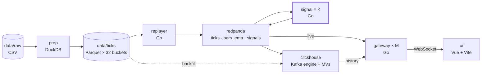

# Stock Signals — Plan

> **Superseded** by [PLAN-2026-11-04.md](PLAN-2026-11-04.md). Kept for history; parts of it (for example, prep sorting by event time) no longer match the code.

Short, opinionated version of the implementation plan. It is the spec for the starter `compose.yaml`.

We replay a week of DEBS 2022 tick data, compute EMA(38) and EMA(100) per symbol over 5-minute windows, and push BUY/SELL crossovers to a browser. The stack: **DuckDB prep → Redpanda → Go signal service → ClickHouse → Go gateway → Vue UI**. Everything runs in Docker Compose. The base config runs on macOS, Windows and Linux. Benchmark numbers come only from Linux, with a performance override.

## Decisions

| Area | Decision |
| --- | --- |
| Runtime | Containers only. Nothing is installed or built on the host except Docker and Git. |
| Prep | DuckDB (Python container) turns each CSV into 32 Parquet buckets, sorted by event time |
| Broker | Redpanda, single node; Redpanda Console for inspection |
| Signals | Go service, per-symbol state in memory, scaled as a consumer group |
| EMA start | Seed both EMAs with the first close |
| Crossover rule | Fire only when the EMA order flips (see below) |
| Into ClickHouse | Kafka engine tables + materialized views |
| Gateway | Go: WebSocket for live updates, HTTP for history |
| UI | Vue 3 + Vite; Lightweight Charts, Perspective, uPlot |
| Messages | JSON; every timestamp as epoch milliseconds |
| Metrics | Prometheus + Grafana in an optional profile |

## Signal rules

1. Event time = `Trading date` + `Trading time`, in `Europe/Berlin`. Group by symbol.
2. Use tumbling, clock-aligned 5-minute windows. A window closes when a later event arrives for the symbol, or when the partition watermark passes the window end. The watermark is the highest event time seen in the partition; after each bucket-day the replayer also writes a watermark record (empty symbol, `ts_ms` = the following midnight), which closes the day's last windows.
3. **Close.** The `Last` price with the greatest `(event_ts, seq)` in the window.
4. **EMAs.** The first window sets both EMAs to its close. After that:

$$
\mathrm{EMA}_j(w_i) = \mathrm{close}(w_i)\cdot\tfrac{2}{1+j} + \mathrm{EMA}_j(w_{i-1})\cdot\bigl(1-\tfrac{2}{1+j}\bigr), \qquad j \in \{38, 100\}
$$

5. **Signals.** Let `rel = sign(EMA38 − EMA100)`. Emit **BUY** when `rel` turns +1 and the last non-zero `rel` was −1. Emit **SELL** for the reverse. The first non-zero `rel` only sets the baseline.
6. Skip windows with no trades, and keep state for the whole week.

**Why not the ≤ / ≥ rule.** With first-close seeding, both EMAs start equal. On a synthetic day, the ≤ / ≥ rule then fired on the second window for 6 of 6 symbols. The flip rule removes those, and the ClickHouse oracle below matches a Python reference exactly under it.

## Data facts the code must handle

- **Preamble.** 13 lines (11 comments, a header, a commented description). Data rows have 40 fields, against 39 header names.
- **Line endings.** The comments use CRLF, the data LF. Every data row has exactly 40 fields, with no quotes.
- **Reading.** `skip=13` is unsafe in DuckDB 1.5.6: with an explicit dialect it silently drops the first ~339k data rows of Monday, and with the sniffed dialect (`strict_mode=false`) the parallel reader refuses the full file. Prep reads with `comment='#'`, an explicit dialect (`delim=','`, no quote or escape, `new_line='\n'`), 40 VARCHAR columns and `null_padding=true`, and drops the header row with `column00 != 'ID'`. Row counts then equal `awk`'s, and `row_number() OVER ()` keeps file order.
- **Columns.** `column00` ID, `column01` SecType, `column21` Last, `column23` Trading time, `column26` Trading date.
- **Order.** File order is receipt order, not event order: sort during prep.
- **Trading date.** The feed sends only changed fields, so `Trading date` is empty on 92% of trade rows (on every index row). Prep fills it with the file's day; where it is present it always equals that day.
- **Zero prices.** `Last = 0` is a placeholder (the 00:00:00 snapshot before a symbol's first trade, and 27 symbols that only ever send 0 every 15 s); it never follows a real trade. Prep rejects it, or it would seed both EMAs at 0 for 93% of symbols.
- **Sunday.** No trades; it only feeds `instruments` (5,495 symbols).
- **Volume.** About 50–60 M rows per weekday, about 23.5 GB of CSV for the week. Monday: 53,994,554 rows, 11,794,520 trades (21.8%), 4,840 symbols, 07:00–22:35, 87.8% of times with non-zero milliseconds; buckets 263k–553k rows (max/mean 1.50).
- **License.** CC BY-NC-SA 4.0: credit Infront in the UI footer.

## Architecture



## Compose services

| Service | Image / build | Job | Host ports | Profile | Scales by |
| --- | --- | --- | --- | --- | --- |
| `redpanda` | Redpanda image | Broker; internal `redpanda:9092` | 19092 (Kafka), 9644 (admin, metrics) | default | `--smp` (perf) |
| `redpanda-init` | Redpanda image (`rpk`) | Creates topics, then exits | – | default | – |
| `console` | Redpanda Console | Browse topics and consumer lag | 8080 | default | – |
| `clickhouse` | `clickhouse/clickhouse-server` | Storage, history, oracle; runs `clickhouse/init/*` on first start | 8123, 9000 | default | Kafka consumers, threads |
| `prep` | build `./prep` (Python + DuckDB) | CSV → Parquet buckets; loads `instruments` over HTTP | – | `prep` | `PREP_THREADS` |
| `replayer` | build `./replayer` (Go) | Parquet → `ticks`, bucket *k* → partition *k* | – | `replay` | `REPLAY_WORKERS` |
| `signal` | build `./signal` (Go) | EMAs and crossovers → `bars_ema`, `signals` | – | default | `--scale signal=K` (K ≤ 32) |
| `gateway` | build `./gateway` (Go) | `/ws` live push, `/history`, `/metrics` | 8000 | default | `--scale gateway=M` |
| `ui` | `node:22` + Vite dev server | The browser app | 5173 | default | – |
| `prometheus`, `grafana` | official images | Scrape Redpanda, ClickHouse and the Go services | 9090, 3000 | `observe` | – |

**Rules for the compose file:**

- Pin exact image tags in `.env`; never `latest`.
- Scaled services publish no fixed host port. Benchmark clients run inside the compose network.
- Every Go service exposes Prometheus metrics: messages/s, lag, latency histograms.
- Mount `./data` read-only into ClickHouse's `user_files`, so `file()` can read the Parquet buckets for backfill.
- Each gateway instance uses its own consumer group (`gateway-$HOSTNAME`), so it sees every symbol.

## Configuration (`.env`)

| Variable | Default | Used by |
| --- | --- | --- |
| `DATA_DIR` | `./data` | prep, replayer, clickhouse |
| `DAYS` | `081121` (one day) | prep, replayer; the full week on Linux |
| `PARTITIONS` | `32` | redpanda-init, prep (bucket count) |
| `PREP_THREADS` | `4` | prep |
| `REPLAY_WORKERS` | `4` | replayer (goroutines; each owns `bucket % N`) |
| `REPLAY_SPEED` | `max` | replayer (`max`, `1`, `10`, `100`) |
| `REPLAY_FROM` | empty | replayer: start at `HH:MM[:SS]` Berlin time of the first day (empty = first tick) |
| `REPLAY_THREADS` | empty | replayer: CPU threads it may use (`GOMAXPROCS`; empty = all) |
| `EMA_INIT` | `first_close` | signal (`zero` only for oracle comparisons) |
| `REDPANDA_SMP` / `REDPANDA_MEMORY` | `1` / `1G` | redpanda |
| `CH_KAFKA_CONSUMERS` | `4` | ClickHouse init script (renders the Kafka DDL) |
| `RETENTION_BYTES` | `20000000000` | redpanda-init, per topic |
| `CLICKHOUSE_USER` / `CLICKHOUSE_PASSWORD` | `app` / set locally | clickhouse, gateway, prep |

## Layout

```
compose.yaml          compose.perf.yaml      .env.example     .gitattributes
data/raw/             data/ticks/            (both git-ignored)
prep/                 replayer/   signal/    gateway/         ui/
clickhouse/init/      redpanda/              observe/         bench/
```

## Portability (all three OSes)

- **Images.** Every image is multi-arch (amd64 + arm64). Go, Python and Node builds happen in multi-stage Dockerfiles, never on the host.
- **Line endings.** `.gitattributes` holds `* text=auto eol=lf`, so shell and SQL files survive Windows checkouts.
- **Windows.** Clone the repo and keep `data/` inside the WSL2 filesystem, not on `C:`. Bind mounts from `C:` are very slow.
- **Docker Desktop (macOS, Windows).** Give it at least 8 GB of RAM. The base stack needs about 5–6 GB.
- **UI dev server.** Vite runs in its container with polling file watch (bind mounts from macOS and Windows hosts do not deliver file events reliably). `node_modules` lives in a named volume, so host-OS binaries never mix in.
- **Redpanda base config.** `--mode dev-container --smp 1 --memory 1G`, which is safe on any laptop.
- **Laptop data.** Prep and replay one day (`DAYS=081121`). The full week is for the Linux box.

## Linux performance override (`compose.perf.yaml`)

Only numbers from `docker compose -f compose.yaml -f compose.perf.yaml` go in the report.

- **No dev-container mode for Redpanda.** That mode disables fsync and enables write caching, which inflates throughput. Run `--smp ${REDPANDA_SMP} --memory ${REDPANDA_MEMORY} --reserve-memory 0M --check=false`.
- **Pinned cores.** Every service gets a `cpuset` from `.env`. Example for 16 threads: redpanda 0–3, signal 4–7, clickhouse 8–11, replayer 12–13, gateway and load clients 14–15.
- **Storage.** Data and Docker volumes live on a local SSD.
- **Memory.** No limits below the host; ClickHouse gets the remaining RAM.

## Topics and tables

| Topic | Partitions | Key | Payload |
| --- | --- | --- | --- |
| `ticks` | 32 (= bucket) | symbol | symbol, sectype, last, ts_ms, seq, sent_ms |
| `bars_ema` | 32 (same as the symbol's ticks) | symbol | symbol, window_start_ms, open, high, low, close, trades, ema38, ema100 |
| `signals` | 32 | symbol | symbol, window_start_ms, side, close, ema38, ema100, emitted_ms |

`clickhouse/init/10-schema.sql` was tested in embedded ClickHouse (chDB):

```sql
CREATE TABLE instruments (
    symbol LowCardinality(String), exchange LowCardinality(String),
    sectype LowCardinality(String), isin String, currency LowCardinality(String)
) ENGINE = ReplacingMergeTree ORDER BY symbol;

CREATE TABLE ticks (
    symbol   LowCardinality(String),
    sectype  LowCardinality(String),
    last     Float64 CODEC(Gorilla, ZSTD),
    event_ts DateTime64(3, 'Europe/Berlin') CODEC(DoubleDelta, ZSTD),
    seq      UInt64
) ENGINE = MergeTree PARTITION BY toDate(event_ts) ORDER BY (symbol, event_ts, seq);

CREATE TABLE bars_5m (   -- built from ticks, feeds the oracle
    symbol       LowCardinality(String),
    window_start DateTime('Europe/Berlin'),
    open   AggregateFunction(argMin, Float64, Tuple(DateTime64(3, 'Europe/Berlin'), UInt64)),
    high   SimpleAggregateFunction(max, Float64),
    low    SimpleAggregateFunction(min, Float64),
    close  AggregateFunction(argMax, Float64, Tuple(DateTime64(3, 'Europe/Berlin'), UInt64)),
    trades SimpleAggregateFunction(sum, UInt64)
) ENGINE = AggregatingMergeTree ORDER BY (symbol, window_start);

CREATE MATERIALIZED VIEW bars_5m_mv TO bars_5m AS
SELECT symbol, toStartOfFiveMinutes(event_ts) AS window_start,
       argMinState(last, (event_ts, seq)) AS open, max(last) AS high, min(last) AS low,
       argMaxState(last, (event_ts, seq)) AS close, count() AS trades
FROM ticks GROUP BY symbol, window_start;

CREATE TABLE bars_ema (
    symbol LowCardinality(String), window_start DateTime('Europe/Berlin'),
    open Float64, high Float64, low Float64, close Float64,
    trades UInt32, ema38 Float64, ema100 Float64
) ENGINE = ReplacingMergeTree PARTITION BY toDate(window_start) ORDER BY (symbol, window_start);

CREATE TABLE signals (
    symbol LowCardinality(String), window_start DateTime('Europe/Berlin'),
    side Enum8('BUY' = 1, 'SELL' = 2),
    close Float64, ema38 Float64, ema100 Float64,
    emitted_at DateTime64(3, 'Europe/Berlin')
) ENGINE = ReplacingMergeTree ORDER BY (symbol, window_start);
```

`clickhouse/init/20-kafka.sh` renders the Kafka tables, with `${CH_KAFKA_CONSUMERS}` filled in from the environment. Embedded ClickHouse accepted the DDL and the view conversions; consuming from a live broker is untested. `bars_ema` and `signals` follow the same pattern. They convert `window_start_ms` with `toDateTime(intDiv(window_start_ms, 1000), 'Europe/Berlin')` and cast `side` to the enum.

```sql
CREATE TABLE ticks_queue (symbol String, sectype String, last String, ts_ms Int64, seq UInt64, sent_ms Int64)
ENGINE = Kafka
SETTINGS kafka_broker_list = 'redpanda:9092', kafka_topic_list = 'ticks',
         kafka_group_name = 'ch-ticks', kafka_format = 'JSONEachRow',
         kafka_num_consumers = ${CH_KAFKA_CONSUMERS}, kafka_thread_per_consumer = 1,
         kafka_handle_error_mode = 'stream',
         input_format_json_read_numbers_as_strings = 1, precise_float_parsing = 1;

CREATE MATERIALIZED VIEW ticks_queue_mv TO ticks AS
SELECT symbol, sectype, toFloat64(last) AS last,
       fromUnixTimestamp64Milli(ts_ms, 'Europe/Berlin') AS event_ts, seq
FROM ticks_queue WHERE length(_error) = 0 AND symbol != ''   -- '' = watermark record
SETTINGS precise_float_parsing = 1;
```

**Floats arrive as text.** ClickHouse's JSON reader ignores `precise_float_parsing` and can land one ULP off (`4.94` → `4.9399999999999995`). That was enough for 5,296 EMAs and 2 signals of the oracle to differ from the service. All float columns of the three Kafka tables are therefore read as strings and converted with `toFloat64` under precise parsing. Watermark records go to `ticks_watermarks`, unparseable messages to `kafka_errors`.

**Oracle** (`clickhouse/oracle.sql`). It uses first-close seeding and the flip rule. On a synthetic day it matched the Python reference: 11 of 11 signals.

```sql
WITH 2 / 39 AS a38, 2 / 101 AS a100,
bars AS (
    SELECT symbol, window_start, argMaxMerge(close) AS close
    FROM bars_5m GROUP BY symbol, window_start
),
series AS (
    SELECT symbol,
           arraySort(groupArray(window_start))                              AS w,
           arrayMap(x -> x.2, arraySort(groupArray((window_start, close)))) AS c
    FROM bars GROUP BY symbol
),
ema AS (
    SELECT symbol, w,
           arrayFold((acc, x) -> arrayPushBack(acc,
                        (x * a38  + acc[-1].1 * (1 - a38),
                         x * a100 + acc[-1].2 * (1 - a100))),
                     arraySlice(c, 2), [(c[1], c[1])]) AS e
    FROM series
),
flat AS (
    SELECT symbol, w_i AS window_start, e_i.1 AS ema38, e_i.2 AS ema100,
           sign(e_i.1 - e_i.2) AS rel
    FROM ema ARRAY JOIN w AS w_i, e AS e_i
),
cmp AS (
    SELECT *,
           anyLast(nullIf(rel, 0)) OVER (PARTITION BY symbol ORDER BY window_start
               ROWS BETWEEN UNBOUNDED PRECEDING AND 1 PRECEDING) AS prev_rel
    FROM flat
)
SELECT symbol, window_start,
       multiIf(rel = 1 AND prev_rel = -1, 'BUY', rel = -1 AND prev_rel = 1, 'SELL', '') AS signal
FROM cmp WHERE signal != ''
ORDER BY symbol, window_start;
```

## Prep (`prep/prep_day.sql`, run per day)

```sql
CREATE TABLE day AS
SELECT column00 AS symbol, column01 AS sectype,
       TRY_CAST(column21 AS DOUBLE) AS last,
       try_strptime(coalesce(column26, '08-11-2021') || ' ' || column23, '%d-%m-%Y %H:%M:%S.%g')
           AT TIME ZONE 'Europe/Berlin' AS event_ts,
       row_number() OVER () AS seq,
       hash(column00) % 32 AS bucket
FROM read_csv('/data/raw/081121.csv', header=false, comment='#', auto_detect=false,
              delim=',', quote='', escape='', new_line='\n', null_padding=true,
              columns={'column00': 'VARCHAR', ..., 'column39': 'VARCHAR'})
WHERE column00 != 'ID' AND column21 IS NOT NULL AND column23 IS NOT NULL;

-- for k in 0..31: one COPY per bucket keeps each file in order
COPY (SELECT symbol, sectype, last, event_ts, seq FROM day
      WHERE bucket = 7 AND event_ts IS NOT NULL AND last > 0
      ORDER BY event_ts, seq)
TO '/data/ticks/bucket=07/081121.parquet' (FORMAT parquet, COMPRESSION zstd);
```

The prep job also prints the rejects, rows per bucket and the trade-row share. Pin the DuckDB version, because `hash()` can change between releases.

## Build order

1. **`prep` on Monday's file.** Confirm the 13-line preamble and millisecond times; record the trade-row share and bucket balance.
2. **`compose up`.** Redpanda, topics, ClickHouse with its schema, Console.
3. **`replayer` → `ticks`.** After each run, ClickHouse row counts must equal topic offsets.
4. **`signal`.** A full week must match `oracle.sql` exactly. **This gate comes before any UI work.**
5. **`gateway` and `ui`.**
6. **Perf override on Linux, then the benchmark sweeps.**

## Benchmark knobs

| Stage | Knob | How |
| --- | --- | --- |
| Prep | DuckDB threads | `PREP_THREADS` |
| Broker | Redpanda shards | `REDPANDA_SMP` (perf override) |
| Replay | Producer workers | `REPLAY_WORKERS` |
| Signals | Consumers | `docker compose up --scale signal=K` |
| ClickHouse ingest | Kafka consumers | `CH_KAFKA_CONSUMERS`, then re-create the Kafka tables |
| Fan-out | WebSocket clients | A load-client service inside the network (later) |

For every point: pin cores, pre-fill the topic and time the drain, run three times, and report the median.

## Status (2026-10-18)

Steps 1–5 run on the laptop with Monday (`DAYS=081121`); step 6 needs the Linux box.

- **Gates.** `clickhouse/check.sh` passes from a clean `docker compose down -v`: ClickHouse rows equal the topic offsets, and the service's 373,126 bars, their EMAs (bit for bit) and its 5,735 signals equal `bars_5m` and `oracle.sql`. They also match when the group is scaled from 1 to 4 instances mid-drain. A newly assigned partition is rebuilt from offset 0 up to its committed offset without emitting, and offsets are committed only after the outputs are acknowledged.
- **Laptop numbers** (dev-container mode, not for the report): prep 51 s per day (4 threads); replay 0.9–1.3 M ticks/s; `bench/signal-drain.sh K` drains Monday at 0.71 M records/s with K = 1, 1.15 M with 2 and 1.47 M with 4 (container start included).
- **Open question: rounding-noise baselines.** After a flat start, both EMAs differ only by rounding (|EMA38 − EMA100| ≤ 1e-12 relative), and that sign becomes the baseline. On Monday, 229 of the 5,735 signals flip from such a baseline. The service and the oracle agree because both follow rule 5 to the letter. Treating |Δ| ≤ ε·|EMA100| as `rel = 0` would remove these signals, but that changes the spec and the oracle.
- **Deviations.** The gateway publishes a fixed 8000 in the base setup; `compose.perf.yaml` removes it so the gateway can scale. Gateways never commit offsets: a restarted instance starts at the live end, and earlier data comes from ClickHouse.

## Todo

Tick an item off (`- [x]`) in the commit that finishes it. The reasons and commands are in
`performance-next-steps.md`, which maps each item to the evaluation criteria.

**Functionality**
- [ ] Follow the spec: `EMA_INIT=zero` and the ≤/≥ crossover rule as defaults, with `first_close` + flip kept as a measured variant.
  - [ ] `CROSSOVER_RULE=spec|flip` in the signal service (compare with the previous window's EMAs, (0, 0) before the first).
  - [ ] Zero seeding and the spec rule in `oracle.sql`, chosen by the same settings and passed through by `check.sh`.
  - [ ] Unit tests: first window under `zero`; the sequences −,0,+ / +,0,+ / −,0,−.
  - [ ] Change the defaults in `.env.example`, `compose.yaml` and the service, and update the signal rules above.
  - [ ] Count each variant's signals on the week (first-window BUYs, ties, the 229 rounding-noise flips).
  - [ ] Check that the price chart still reads well when the EMAs start near 0.
- [ ] Pass `clickhouse/check.sh` on the whole week (Mon–Fri) in one run, not only on Monday.

**Late and out-of-order events**
- [ ] Measure disorder in the raw CSVs in file order: share of late trade rows per symbol and per bucket, lateness p50/p99/max per exchange.
- [ ] `PREP_ORDER=receipt`: buckets in file order instead of event-time order.
- [ ] Bounded out-of-orderness in the signal service (`ALLOWED_LATENESS`); windows close when the watermark passes their end.
- [ ] Sweep `ALLOWED_LATENESS`: late ticks, results that differ from the oracle, and latency.

**Performance and scalability (Linux, `compose.perf.yaml`)**
- [ ] Replay the whole week at full speed, and again at a fixed speed (e.g. 300×), to show stable latency.
- [ ] Scaling sweep: 1/2/4/8 signal instances and varied `CPUS_SIGNAL`, with `docker stats` CPU and memory logged per run.
- [ ] Results per exchange (FR/NL/ETR alone, then all three).
- [ ] Ticks per partition and per instance (long tail, hot symbols); try a greedy symbol-to-bucket map if one partition is the bottleneck.
- [ ] Subscriber scaling: 1–1000 probe clients, then `--scale gateway=M`.

**Creative explorations**
- [ ] Signal service: one goroutine per partition, no blocking on produce and commit; compare with N instances.
- [ ] Periodic watermarks from the replayer, bounded by `ALLOWED_LATENESS`.
- [ ] Configurable gateway flush interval (50 ms against 250 ms).

**Report (ACM template, 4–5 pages)**
- [ ] Dataset analysis: extend `notebooks/dataset_overview.ipynb` per exchange and per security type, trade events against all events, the peaks.
- [ ] Explain how tick, housekeeping and metadata (`instruments`) rows are handled, and the normalization.
- [ ] State the relaxations: windows without trades are skipped, every client gets every signal.
- [ ] Describe the visualization, with screenshots.
- [ ] Each member answers the three teamwork questions.

**Broker and documentation**
- [ ] Is Redpanda free to use, and is it acceptable for the course (or does the course require Kafka itself)? See the open questions in `stock-signals-implementation-plan.md`.
  - [ ] Replication factor 1 on one broker means no fault tolerance: state it as out of scope in the report, or show a 3-broker run (free in Community Edition).
  - [ ] Dev-container mode disables fsync: report benchmark numbers from `compose.perf.yaml` and say so.
  - [ ] Find the broker's scaling ceiling: defaults are `REDPANDA_SMP=1`, `REDPANDA_MEMORY=1G`; if Redpanda is the bottleneck, show the effect of more SMP and partitions.
  - [ ] Justify Redpanda over Kafka as lighter operations, not a Kafka-missing feature, so the design carries over to Kafka.
- [ ] Understand, clarify and document the logic of the EMA calculations. How does it work with rolling windows, if we use those instead of tumbling windows?
- [ ] Document the interfaces between components, with examples of what data is transferred and how.

## Sources

- Full implementation plan (`stock-signals-implementation-plan.md`)
- [rpk redpanda start: `--mode dev-container`](https://docs.redpanda.com/streaming/26.1/reference/rpk/rpk-redpanda/rpk-redpanda-start.md)
- [ClickHouse Kafka table engine](https://clickhouse.com/docs/en/engines/table-engines/integrations/kafka)
- [DEBS 2022 Grand Challenge](https://2022.debs.org/call-for-grand-challenge-solutions/)
