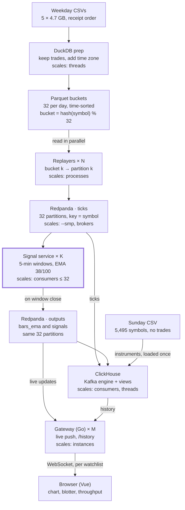
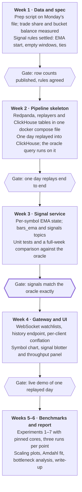

# Stock Signals: Implementation Plan

Oct 17, 2026 · Kauri Halttunen

## Summary

We rebuild the DEBS 2022 Grand Challenge as a browser app. The app replays a week of Infront tick data, computes EMA(38) and EMA(100) per symbol over 5-minute windows, and pushes BUY/SELL crossovers to the browser. The default stack is DuckDB → Redpanda → a stateful signal service → ClickHouse → a WebSocket gateway → a Vue UI. Every stage scales by adding partitions, threads or instances.

Two facts from the data shape the plan. The Sunday file contains no trades at all. File order is receipt order, not event time.

| Decision | Default pick | Alternative | Choose the alternative when |
| --- | --- | --- | --- |
| A. CSV prep | DuckDB → Parquet, 32 symbol buckets sorted by event time | Load CSV straight into ClickHouse | You only need history, not a live replay |
| B. Broker | Redpanda | Apache Kafka | The course requires Kafka, or you want a Kafka-vs-Redpanda run |
| C. Signal computation | Stateful signal service (Go or Rust) consuming `ticks` | ClickHouse SQL only; or Flink / RisingWave | You want fewer services (SQL), or managed state and checkpoints (Flink) |
| D. Into ClickHouse | Kafka table engine + materialized views | External consumer with batched inserts; direct Parquet load | You need custom error handling; backfills and raw-ingest benchmarks |
| E. Gateway | Go service: live updates from Redpanda, history from ClickHouse, over WebSocket | Poll ClickHouse; Server-Sent Events | Very few clients; updates only flow one way |
| F. UI | Vue 3 + Lightweight Charts, with Perspective for the signal table | uPlot; Perspective only | Plain line charts at maximum speed; a table-only view |

## The data

The Sunday file (`141121.csv`, 14 Nov 2021) holds reference data only: 26,113 rows, 5,495 symbols and zero trades. Use it to build an `instruments` table. Test the signal path on Monday's file.

| Measure (Sunday file) | Value |
| --- | --- |
| Data rows | 26,113 (ETR 11,996 · FR 11,259 · NL 2,858) |
| Distinct symbols | 5,495 |
| Equity / index rows | 16,100 / 10,013 |
| Rows with a `Last` price or `Trading time` | 0 |
| Filled reference fields | Currency 5,492 · ISIN 5,483 · Nominal value 1,679 · Related indices 219 |
| Average row size | 73 bytes |

**Weekday volume.** The challenge counts 289 million events for the whole week. Five 4.7 GB weekday files total about 23.5 GB. Expect roughly 50–60 million rows per weekday, at about 80 bytes per row. Only rows with a `Last` price feed the signals, so measure that share on Monday's file first.

**Columns we keep.** The challenge marks five of the 39 columns as relevant: `ID` (symbol with exchange suffix), `SecType`, `Last`, `Trading time` and `Trading date`. Everything else is dropped during prep.

**Parsing pitfalls found in the Sunday file:**

- **Preamble.** There are 13 preamble lines: 11 comment lines, the header, and a commented description line. Data rows carry 40 fields against 39 header names, because of a trailing comma.
- **Mixed line endings.** The comment lines end in CRLF and the data in LF. DuckDB's CSV sniffer rejects this mix. This call works (tested: 26,113 rows, 5,495 symbols): `read_csv(path, header=false, skip=13, all_varchar=true, strict_mode=false)`. It reads positional columns: `column00` = ID, `column01` = SecType, `column21` = Last, `column23` = Trading time, `column26` = Trading date. Check that Monday's preamble is also 13 lines (`head -14`).
- **Malformed times.** Values such as `::` occur. Parse with `try_strptime` and count rejects.
- **File order is not event order.** In the Sunday file, 14,487 of 20,640 rows with a valid time stamp are earlier than a row above them. The worst is 23.8 hours behind. Sort by event time during prep; never replay file order.
- **Time zone.** Times are exchange wall-clock time; all three exchanges ran on CET in November 2021. Attach `Europe/Berlin` during prep. In our test, skipping this shifted every ClickHouse window by one hour.
- **License.** The data is CC BY-NC-SA 4.0. Credit Infront in the UI footer and the report.

## Signal definition

A BUY fires when EMA(38) rises above EMA(100) at the close of a 5-minute window. A SELL fires when it falls below. This is Query 2 of the DEBS 2022 Grand Challenge, which this dataset was published for.

1. **Group by symbol.** Event time = `Trading date` + `Trading time`.
2. **Window.** Use tumbling 5-minute windows, clock-aligned (09:00, 09:05, …). Evaluate a window only once the next one has started.
3. **Close.** A window's close is the `Last` price with the latest event time inside it. Break ties by arrival order.
4. **EMA update.** Update both EMAs once per window:

$$
\mathrm{EMA}_j(w_i) = \mathrm{close}(w_i)\cdot\frac{2}{1+j} + \mathrm{EMA}_j(w_{i-1})\cdot\Bigl(1-\frac{2}{1+j}\Bigr), \qquad j \in \{38, 100\}
$$

5. **Crossovers.** Compare this window with the previous one:

$$
\begin{aligned}
\text{BUY at } w_i &\iff \mathrm{EMA}_{38}(w_i) > \mathrm{EMA}_{100}(w_i) \;\wedge\; \mathrm{EMA}_{38}(w_{i-1}) \le \mathrm{EMA}_{100}(w_{i-1}) \\
\text{SELL at } w_i &\iff \mathrm{EMA}_{38}(w_i) < \mathrm{EMA}_{100}(w_i) \;\wedge\; \mathrm{EMA}_{38}(w_{i-1}) \ge \mathrm{EMA}_{100}(w_{i-1})
\end{aligned}
$$

6. **What the UI receives.** For each symbol on a user's watchlist: the latest two EMAs and the last three crossovers with timestamps. The DEBS evaluator asked for exactly this per subscribed symbol, which maps directly onto a watchlist.

**Decisions to settle before coding:**

| Question | Options | Our default |
| --- | --- | --- |
| EMA starting value | 0, or the first close | First close, with a `zero_init` flag for 0. Starting at 0 fires a BUY on every symbol's first window. In a synthetic random-walk test it also delayed the first SELL by a median of 285 windows, about 2.5 trading days. At least one DEBS 2022 team also started from the first value. |
| Windows with no trades | Skip the window, or carry the last close forward | Skip: the EMAs only advance on windows with trades. Carrying forward across the overnight gap leaves both EMAs nearly equal by the open, so the first morning trade flips them. |
| Ties (equal EMAs) | Count as a cross, or ignore | Use the ≤ / ≥ rules above, as written |
| State across days | Reset daily, or keep for the whole week | Keep for the week (the replay runs Monday to Friday) |

## Architecture



Signals reach the browser without a database round trip. Prep runs once per file. Replayers, the signal service, ClickHouse and the gateways run continuously, and each scales by adding copies or threads. Live updates go from Redpanda straight to the gateway. ClickHouse serves history and the oracle.

## Variant A — Preparing the CSVs

Convert each weekday CSV once, with DuckDB, into 32 Parquet buckets sorted by event time. Everything downstream reads those files, never the raw CSV.

| Option | How it works | Strengths | Weaknesses |
| --- | --- | --- | --- |
| **A1. DuckDB → Parquet buckets (default)** | Parse, keep trade rows, attach the time zone, sort by event time, write one file per bucket per day | CSV is parsed once; files are typed, compressed and far smaller; replayers run in parallel without a shared reader; order is guaranteed | One extra step; the bucket count is fixed at prep time |
| A2. CSV straight into ClickHouse | `INSERT … SELECT … FROM file('*.csv')` | One step; ClickHouse parses CSV in parallel | No replay order, so no live stream; the CSV quirks must be handled in ClickHouse settings instead |
| A3. Replayer reads the raw CSV | The producer parses rows and sends them as it goes | No intermediate files | One reader per 4.7 GB file caps throughput; out-of-order rows reach the stream |

**Why buckets.** A symbol's ticks must stay in order, so each symbol lives in exactly one bucket, and bucket *k* is written to partition *k*. Each replayer owns a set of buckets, so producers scale without coordinating. Every partition is time-sorted, so the signal service can use the latest event time it has seen as its watermark.

```sql
-- prep_day.sql: one weekday CSV → 32 time-sorted Parquet buckets
CREATE TABLE day AS
SELECT column00                                  AS symbol,
       column01                                  AS sectype,
       TRY_CAST(column21 AS DOUBLE)              AS last,
       try_strptime(column26 || ' ' || column23,
                    '%d-%m-%Y %H:%M:%S.%g')
           AT TIME ZONE 'Europe/Berlin'          AS event_ts,
       row_number() OVER ()                      AS seq,    -- arrival order, breaks ties
       hash(column00) % 32                       AS bucket
FROM read_csv('raw/081121.csv', header=false, skip=13,
              all_varchar=true, strict_mode=false)
WHERE column21 IS NOT NULL AND column23 IS NOT NULL;

-- report this number: rows with a price we could not parse
SELECT count(*) FILTER (WHERE event_ts IS NULL OR last IS NULL) AS rejects FROM day;

-- one COPY per bucket (k = 0..31, from a shell loop) guarantees order inside each file
COPY (SELECT symbol, sectype, last, event_ts, seq
      FROM day
      WHERE bucket = 7 AND event_ts IS NOT NULL AND last IS NOT NULL
      ORDER BY event_ts, seq)
TO 'ticks/bucket=07/081121.parquet' (FORMAT parquet, COMPRESSION zstd);
```

We ran this SQL on a synthetic day in the DEBS format: every bucket came out in order. On the Sunday file it returns 0 trades, as expected.

**Notes:**

- **Bucket count.** 32 buckets set the maximum parallelism you can test. Pick the largest consumer count you plan to benchmark.
- **Skew.** Liquid symbols make some buckets heavier than others. After prep, compare row counts per bucket. If the largest is far above the mean, assign symbols to buckets greedily by row count, using a mapping table, instead of by hash.
- **Pin the DuckDB version.** `hash()` is not guaranteed to be stable across versions.
- **High reject count.** Check the number of fraction digits in `Trading time`. `%g` expects milliseconds.

## Variant B — Broker: Redpanda or Kafka

Use Redpanda for development and the main runs. Keep one Kafka run as a comparison: both speak the Kafka protocol, so the same client code works unchanged.

| Aspect | Redpanda | Apache Kafka |
| --- | --- | --- |
| Runtime | C++ single binary, one thread per core | JVM; KRaft is the only mode since 4.0, with no ZooKeeper |
| Core-scaling knob | `--smp N` (shards = cores) | `num.network.threads`, `num.io.threads`, plus JVM heap |
| Local setup | One container | One container in combined broker + controller mode |
| Built-in UI | Redpanda Console | None; add a third-party UI if needed |
| Benchmark tool | Kafka's `kafka-producer-perf-test` works against it | `kafka-producer-perf-test`, which has a warm-up option since 4.2 ([release notes](https://kafka.apache.org/blog/2026/02/17/apache-kafka-4.2.0-release-announcement/)) |
| License | Community Edition under the Business Source License | Apache 2.0 |

**Topic and producer settings (both brokers):**

- **`ticks` topic.** 32 partitions, matching the buckets. Replication factor 1 on one machine; say so in the report.
- **Explicit partitioning.** The producer sets `partition = bucket` and still sends `key = symbol`. Never rely on the default key hash, which would scatter a bucket across partitions.
- **Batching.** `linger.ms` 5–20, `batch.size` 256 KB–1 MB, `compression.type=lz4`. Fix these for all runs and record them.
- **Delivery.** `acks=all` with idempotence on. Run `acks=1` only as a labelled side experiment.
- **Message format.** Start with JSON: it is readable and ClickHouse ingests it as `JSONEachRow`. Message size drives broker throughput, so treat a binary format (Protobuf) as a later experiment.
- **Retention.** Set `retention.bytes` per topic, so a few full replays cannot fill the disk.

**When Kafka should be the default instead:** the course explicitly requires Kafka, or you want Share Groups (queue semantics, production-ready since 4.2).

## Variant C — Where the signals are computed

Compute signals in a small stateful service that consumes `ticks`. Keep a ClickHouse SQL version as the correctness oracle. Of all the variants, this choice changes the architecture most.

| Option | Where EMA state lives | How the browser gets signals | Scales by | Effort |
| --- | --- | --- | --- | --- |
| **C1. Signal service (default)** | In memory, per partition, in Go or Rust | Pushed within one window close | Consumer instances, up to 32 | Medium: about 300 lines plus tests |
| C2. ClickHouse only | Recomputed from 5-minute bars at query time | Polling | ClickHouse query threads | Low: SQL only |
| C3. Flink or RisingWave | Managed by the platform, with checkpoints | Pushed | Operator parallelism | High |

**C1: how the service works.** Each consumer owns some partitions. For each symbol it keeps:

- the current window start and close;
- both EMAs and the previous relation between them;
- the last three crossovers.

When a tick lands in a later window, the open window is finalised: update the EMAs, test for a crossover, and emit a row to `bars_ema` (plus `signals` on a cross). A symbol that stops trading is finalised when the partition's watermark passes its window end. The watermark is the latest event time seen in that partition. Partitions never share symbols, so there are no locks. Use Go (franz-go) or Rust (rdkafka); Python's per-message overhead would dominate the numbers you are trying to scale.

**C1: the catch.** State lives in memory. If partitions move between consumers, the new owner starts cold. For benchmarks, fix the consumer count per run. For resilience, rebuild a partition's state by replaying it from the start of the day before resuming.

**C2: what you gain and lose.** No extra service, and everything is SQL. But a signal exists only when someone asks, every query recomputes the EMA recursion from the start of the history, and the UI must poll.

**C3: when it is worth it.** Choose Flink if the course grades stream-processing theory: event time, watermarks, checkpoints, exactly-once. A DEBS 2022 team built their solution on Flink. The recursive EMA needs a custom keyed process function there. Check whether RisingWave can express it before choosing RisingWave.

**The oracle (C2 query, tested).** On a synthetic day in the DEBS format, this query matched a Python reference exactly: the same EMAs in all 682 windows and the same signals. It starts the EMAs at 0, so compare it against the service running in `zero_init` mode.

```sql
WITH 2 / 39 AS a38, 2 / 101 AS a100,
bars AS (
    SELECT symbol, window_start, argMaxMerge(close) AS close
    FROM bars_5m GROUP BY symbol, window_start
),
ema AS (  -- the recursion, folded over each symbol's sorted closes
    SELECT symbol,
           arrayFold((acc, c) -> arrayPushBack(acc,
                        (c * a38  + acc[-1].1 * (1 - a38),
                         c * a100 + acc[-1].2 * (1 - a100))),
                     arrayMap(x -> x.2, arraySort(groupArray((window_start, close)))),
                     CAST([], 'Array(Tuple(Float64, Float64))')) AS e,
           arraySort(groupArray(window_start)) AS w
    FROM bars GROUP BY symbol
),
flat AS (
    SELECT symbol, w_i AS window_start, e_i.1 AS ema38, e_i.2 AS ema100
    FROM ema ARRAY JOIN w AS w_i, e AS e_i
),
cmp AS (
    SELECT *,
           lagInFrame(ema38,  1, 0) OVER (PARTITION BY symbol ORDER BY window_start) AS prev38,
           lagInFrame(ema100, 1, 0) OVER (PARTITION BY symbol ORDER BY window_start) AS prev100
    FROM flat
)
SELECT symbol, window_start,
       multiIf(ema38 > ema100 AND prev38 <= prev100, 'BUY',
               ema38 < ema100 AND prev38 >= prev100, 'SELL', '') AS signal
FROM cmp
WHERE signal != ''
ORDER BY symbol, window_start;
```

`arrayPushBack` inside the fold copies the array at every step, so cost grows with the square of the window count. That is fine for an oracle over one week (under about 1,000 windows per symbol), but not for the live path.

## Variant D — Getting data into ClickHouse

Let ClickHouse consume `ticks`, `bars_ema` and `signals` itself, through Kafka engine tables and materialized views. Use direct Parquet loads for backfill and for an ingest-only benchmark.

| Option | How it works | Strengths | Weaknesses |
| --- | --- | --- | --- |
| **D1. Kafka engine + materialized view (default)** | One `Kafka` table per topic. A materialized view copies each consumed block into a MergeTree table. | No extra service. Scales with `kafka_num_consumers`, capped by both the partition count and the physical core count. `kafka_thread_per_consumer = 1` flushes each consumer in parallel. | Parse errors are easy to miss (set `kafka_handle_error_mode = 'stream'`). Offsets are committed before rows are fsynced, so a power loss can drop rows silently. |
| D2. External consumer | The signal service, or a separate sink, batches rows and inserts over the native protocol | Full control over batching, retries and metrics | One more component to write, tune and scale |
| D3. Direct Parquet load | `INSERT INTO ticks SELECT … FROM file('ticks/*/*.parquet', Parquet)` | Fastest way to load history; isolates ClickHouse ingest speed from the broker | Not live |

The consumer limits, error modes and fsync caveat are from the [ClickHouse Kafka engine docs](https://clickhouse.com/docs/en/engines/table-engines/integrations/kafka).

**Insert sizes.** ClickHouse writes each insert as a new data part, so many tiny inserts are slow. The Kafka engine flushes when a block reaches `kafka_max_block_size` or when `kafka_flush_interval_ms` passes. Under D2, send at least 10,000 rows per insert or enable `async_insert`.

**Pick D2 instead** if parse errors or the fsync window become a problem in testing. The signal service already holds batches of rows, so writing them to ClickHouse directly is a small change.

## Variant E — Gateway and browser transport

A Go gateway pushes live bars and signals from Redpanda over WebSocket, and serves history from ClickHouse. Each browser subscribes to a watchlist of symbols, which mirrors the DEBS subscription model.

| Choice | Default | Alternative | Trade-off |
| --- | --- | --- | --- |
| Live source | Consume the `bars_ema` and `signals` topics | Poll ClickHouse every *N* ms | Polling is simpler, but latency equals the interval and query load grows with clients |
| Transport | WebSocket | Server-Sent Events | SSE is one-way, so changing a watchlist needs separate HTTP calls |
| Encoding | JSON | MessagePack or Arrow IPC | Binary cuts gateway CPU and bytes; switch only if profiling points at JSON |
| Language | Go (franz-go, coder/websocket) | Node with uWebSockets.js; Rust with axum | Go gives simple concurrency and a mature Kafka client |

**How it works:**

1. **Consume everything.** Each gateway instance reads every partition of `bars_ema` and `signals`, under its own consumer group, so every instance sees every symbol.
2. **Snapshot on subscribe.** The gateway keeps the latest EMAs and last three crossovers per symbol in memory. A new subscription gets that snapshot immediately.
3. **History over HTTP.** `GET /history?symbol=SIE.ETR&from=…&to=…` queries ClickHouse for bars, EMAs and signals, to draw a chart before live updates start.
4. **Conflate per client.** Every 100 ms, send one frame per client holding only the newest bar per subscribed symbol. Never drop signals. A slow browser then costs memory for one frame, not an unbounded queue.
5. **Stamp for latency.** Messages carry the tick's event time and the replayer's send time. The browser records its receive time, so you can report end-to-end latency (p50 / p99) on one machine clock.

**Scaling.** Gateways scale horizontally, but each one reads the full output stream. Measure clients per instance, not just total throughput.

## Variant F — The UI

Build the UI in Vue 3 + Vite, with three panels. Each panel uses the library best suited to it.

| Panel | Shows | Library | Why this one |
| --- | --- | --- | --- |
| Symbol chart | 5-minute candles, EMA(38) and EMA(100) lines, BUY/SELL arrows | Lightweight Charts | Candles, line overlays and series markers are built in. Check its attribution requirement. |
| Signal blotter | Every crossover across all 5,495 symbols, sortable and filterable | Perspective | A WebAssembly engine built for streaming tables, fed with Arrow or JSON |
| Throughput panel | Ticks/s, signals/s, gateway messages/s, end-to-end latency | uPlot | Very fast plain time-series lines; ideal for a live demo of scaling |

**Alternatives:**

- **uPlot only.** Fastest, but candles and markers would be drawn by hand.
- **Perspective only.** Strong for tables and pivots, but weaker as a trading chart.
- **Plain canvas.** Maximum control, weeks of work.

**Rendering rules:**

- **Candles need OHLC.** Each window must carry open, high, low and close, not just the close. The signal service and `bars_5m` compute all four (see Schemas).
- **Batch DOM work.** Append live bars with `series.update()`, never `setData()`. Apply each incoming frame inside one `requestAnimationFrame`.
- **Keep the blotter light.** The blotter subscribes to signals for all symbols. Crossovers are rare compared with ticks, so this costs little.
- **Credit the data.** Show the Infront attribution and the CC BY-NC-SA notice in the footer.

## Schemas

Three topics carry the data, and six ClickHouse tables store it. All of them are keyed by symbol so partitions, buckets and table sort order line up.

| Topic | Partitions | Key | Written by | Read by | Payload fields |
| --- | --- | --- | --- | --- | --- |
| `ticks` | 32 (= bucket) | symbol | Replayers | Signal service, ClickHouse | symbol, sectype, last, ts_ms, seq, sent_ms |
| `bars_ema` | 32 (same partition as the symbol's ticks) | symbol | Signal service | ClickHouse, gateways | symbol, window_start_ms, open, high, low, close, trades, ema38, ema100 |
| `signals` | 32 | symbol | Signal service | ClickHouse, gateways | symbol, window_start_ms, side, close, ema38, ema100, emitted_ms |

The tables below were created and loaded in embedded ClickHouse (chDB). The materialized view produced the same 682 bars as the Python reference, and the Sunday file loaded 5,495 instruments across FR, ETR and NL. The Kafka tables at the end were not run here.

```sql
-- Reference data, loaded once from the Sunday file
CREATE TABLE instruments
(
    symbol   LowCardinality(String),
    exchange LowCardinality(String),
    sectype  LowCardinality(String),
    isin     String,
    currency LowCardinality(String)
)
ENGINE = ReplacingMergeTree
ORDER BY symbol;

-- Raw trades: history charts, the oracle, the ingest benchmark
CREATE TABLE ticks
(
    symbol   LowCardinality(String),
    sectype  LowCardinality(String),
    last     Float64 CODEC(Gorilla, ZSTD),
    event_ts DateTime64(3, 'Europe/Berlin') CODEC(DoubleDelta, ZSTD),
    seq      UInt64
)
ENGINE = MergeTree
PARTITION BY toDate(event_ts)
ORDER BY (symbol, event_ts, seq);

-- 5-minute OHLC bars built inside ClickHouse (oracle and Variant C2)
CREATE TABLE bars_5m
(
    symbol       LowCardinality(String),
    window_start DateTime('Europe/Berlin'),
    open   AggregateFunction(argMin, Float64, Tuple(DateTime64(3, 'Europe/Berlin'), UInt64)),
    high   SimpleAggregateFunction(max, Float64),
    low    SimpleAggregateFunction(min, Float64),
    close  AggregateFunction(argMax, Float64, Tuple(DateTime64(3, 'Europe/Berlin'), UInt64)),
    trades SimpleAggregateFunction(sum, UInt64)
)
ENGINE = AggregatingMergeTree
ORDER BY (symbol, window_start);

CREATE MATERIALIZED VIEW bars_5m_mv TO bars_5m AS
SELECT symbol,
       toStartOfFiveMinutes(event_ts)     AS window_start,
       argMinState(last, (event_ts, seq)) AS open,
       max(last)                          AS high,
       min(last)                          AS low,
       argMaxState(last, (event_ts, seq)) AS close,
       count()                            AS trades
FROM ticks
GROUP BY symbol, window_start;

-- Written by the signal service: one row per symbol per closed window
CREATE TABLE bars_ema
(
    symbol       LowCardinality(String),
    window_start DateTime('Europe/Berlin'),
    open Float64, high Float64, low Float64, close Float64,
    trades       UInt32,
    ema38        Float64,
    ema100       Float64
)
ENGINE = ReplacingMergeTree        -- a repeated replay overwrites, never duplicates
PARTITION BY toDate(window_start)
ORDER BY (symbol, window_start);

CREATE TABLE signals
(
    symbol       LowCardinality(String),
    window_start DateTime('Europe/Berlin'),
    side         Enum8('BUY' = 1, 'SELL' = 2),
    close        Float64,
    ema38        Float64,
    ema100       Float64,
    emitted_at   DateTime64(3, 'Europe/Berlin')
)
ENGINE = ReplacingMergeTree
ORDER BY (symbol, window_start);
```

Each topic gets one Kafka table and one materialized view. `bars_ema` and `signals` follow the same pattern as `ticks`:

```sql
CREATE TABLE ticks_queue
(
    symbol String, sectype String, last Float64,
    ts_ms  Int64,      -- event time as epoch milliseconds: no time-zone ambiguity
    seq    UInt64
)
ENGINE = Kafka
SETTINGS kafka_broker_list         = 'redpanda:9092',
         kafka_topic_list          = 'ticks',
         kafka_group_name          = 'clickhouse-ticks',
         kafka_format              = 'JSONEachRow',
         kafka_num_consumers       = 8,   -- ≤ partitions and ≤ physical cores
         kafka_thread_per_consumer = 1,
         kafka_handle_error_mode   = 'stream';

CREATE MATERIALIZED VIEW ticks_queue_mv TO ticks AS
SELECT symbol, sectype, last,
       fromUnixTimestamp64Milli(ts_ms, 'Europe/Berlin') AS event_ts,
       seq
FROM ticks_queue
WHERE length(_error) = 0;
```

The Sunday file goes into `instruments` through DuckDB. Group by `column00` and take the exchange from the symbol suffix: `regexp_extract(column00, '\.([A-Z]+)$', 1)`. Take the ISIN from `column14` and the currency from `column11`.

## Benchmark plan

Measure each stage in isolation first, then the whole pipeline. Every experiment sweeps one knob and holds everything else fixed.

| # | Experiment | Knob swept | Held fixed | Metric | Expected shape |
| --- | --- | --- | --- | --- | --- |
| 1 | CSV prep | DuckDB `threads`: 1, 2, 4, 8, 16 | One weekday file | MB/s and rows/s parsed | Near-linear until disk read speed caps it |
| 2 | Broker ingest | Redpanda `--smp` 1–8; replayer processes 1–32 | 32 partitions, batch settings | Messages/s, MB/s, p99 produce latency | Rises with cores until disk or network saturates |
| 3 | Signal service | Consumers: 1, 2, 4, 8, 16, 32 | Pre-filled `ticks` topic | Ticks/s while draining the backlog | Near-linear until partitions or cores run out; skew shows up as one slow consumer |
| 4 | ClickHouse ingest | `kafka_num_consumers` 1–16 (D1); insert threads (D3) | Pre-filled topics | Rows/s into `ticks` | D3 sets the ceiling; D1 should approach it |
| 5 | Queries under load | Concurrent `/history` calls: 1–64 | Replay at a fixed rate | p50 / p99 query latency | Flat until cores saturate |
| 6 | End to end | Replay speed: 1×, 10×, 100×, unthrottled | Full stack | Tick-to-browser latency (p50 / p99); signals/s delivered | Flat latency until one stage saturates; name that stage |
| 7 | Fan-out | Headless WebSocket clients: 1–1,000 | Fixed replay rate | Gateway CPU, frames/s, latency | CPU grows linearly per client; conflation caps the per-client cost |

**Rules for every run:**

- **Drain a backlog.** Fill the topic first, then start the consumers and time the drain. This isolates consumer speed from producer speed.
- **Pin cores.** Use `docker run --cpuset-cpus`. Never let the replayer and the service under test share cores.
- **Warm up and repeat.** Discard the first 30 seconds, run each point three times, and report the median and spread.
- **Record everything.** CPU model, core count, RAM, disk, versions and every setting, committed to git next to the results.

**Analysis.** For each sweep, plot throughput against cores with an ideal-linear line from the 1-core point. Report speedup and efficiency, and fit Amdahl's law to estimate the parallel fraction *p*:

$$
S(n) = \frac{T(1)}{T(n)}, \qquad E(n) = \frac{S(n)}{n}, \qquad S_{\text{Amdahl}}(n) = \frac{1}{(1-p) + p/n}
$$

Then explain where each curve bends: serial work, disk or memory bandwidth, or bucket skew. On one machine, "horizontal" scaling with containers still shares disk and memory bandwidth. Say so in the report, and spread brokers and consumers over a second machine if you have one.

## Milestones and team split



Weeks are relative to kickoff; set real dates once the deadline is known. Each phase ends at a gate the whole group checks. Week 3's gate matters most: a fast pipeline that disagrees with the oracle is not worth benchmarking.

| Role | Owns | First deliverable |
| --- | --- | --- |
| Data | DuckDB prep, `instruments`, bucket balance, the oracle | Monday's row counts and the 32 Parquet buckets |
| Streaming | Redpanda, replayers, the signal service | One day replayed into `ticks` |
| Storage and benchmarks | ClickHouse schema and Kafka tables, the benchmark harness, plots | Experiments 3 and 4 running on one day |
| Frontend | Gateway, Vue UI | A watchlist receiving live bars |

With three people, merge Data with Storage and benchmarks. Commit `docker-compose.yml`, every config and every benchmark result to one repository from week 2.

## Risks and open questions

The biggest unknown is how many weekday rows carry a trade price. Answer that on day one with the prep script.

| Risk | Effect | Mitigation |
| --- | --- | --- |
| Unknown share of trade rows | Throughput targets and disk budget are guesses | Run prep on Monday's file first; publish row counts to the team |
| Disk space | 23.5 GB of CSV plus Parquet, broker logs and ClickHouse data | Keep about twice the CSV size free; set `retention.bytes` on every topic |
| Bucket skew | One heavy partition caps scaling | Check rows per bucket after prep; switch to a greedy symbol-to-bucket map |
| State lost on rebalance | Wrong EMAs after a consumer joins or leaves | Fixed consumer count per run; rebuild state by replaying from the day's start |
| Laptop throttling | Scaling curves bend for thermal reasons, not design reasons | Run on a desktop or server; repeat runs; log CPU clock speed |
| Time-zone mistakes | Windows shifted by an hour | Epoch milliseconds in messages; one zone in ClickHouse; compare against the oracle |
| Silent row loss in the Kafka engine | History charts miss data | After every run, compare topic offsets with table row counts |

**Open questions:**

- [ ] How many rows per weekday carry a `Last` price?
- [ ] Does Monday's file have the same 13-line preamble and millisecond times?
- [ ] Does the course require Kafka itself, or is a Kafka-compatible broker acceptable?
- [ ] EMA start: first close (our default) or 0?
- [ ] Which machine runs the benchmarks, and is a second machine available?
- [ ] When are the demo and the report due?

## Sources

- [DEBS 2022 Grand Challenge: call for solutions](https://2022.debs.org/call-for-grand-challenge-solutions/). Queries, window rules, relevant columns, 289 million events, license.
- [DEBS 2022 Trading Data on Zenodo](https://doi.org/10.5281/zenodo.6382482). The dataset, as cited in the file header.
- [Li et al., DEBS 2022 Grand Challenge solution](https://vgate.cs.ucy.ac.cy/debs2022/pdfs/debs2022-26.pdf). EMA recurrence with α = 2/(1+j), starting from the first value.
- [Calavaro et al., Real-time analysis of market data leveraging Apache Flink](https://art.torvergata.it/handle/2108/305214). A Flink-based DEBS 2022 solution.
- [ClickHouse Kafka table engine](https://clickhouse.com/docs/en/engines/table-engines/integrations/kafka). Consumer limits, error modes, fsync caveat.
- [ClickHouse 23.10 release](https://clickhouse.com/blog/clickhouse-release-23-10). `arrayFold`.
- [Apache Kafka 4.2.0 release announcement](https://kafka.apache.org/blog/2026/02/17/apache-kafka-4.2.0-release-announcement/). Share Groups production-ready; producer perf-test warm-up (KIP-1052).
- Our own measurements: the Sunday file profile, and the synthetic-day tests of the prep SQL, schema and oracle (DuckDB 1.5.6, chDB 4.4.0).
